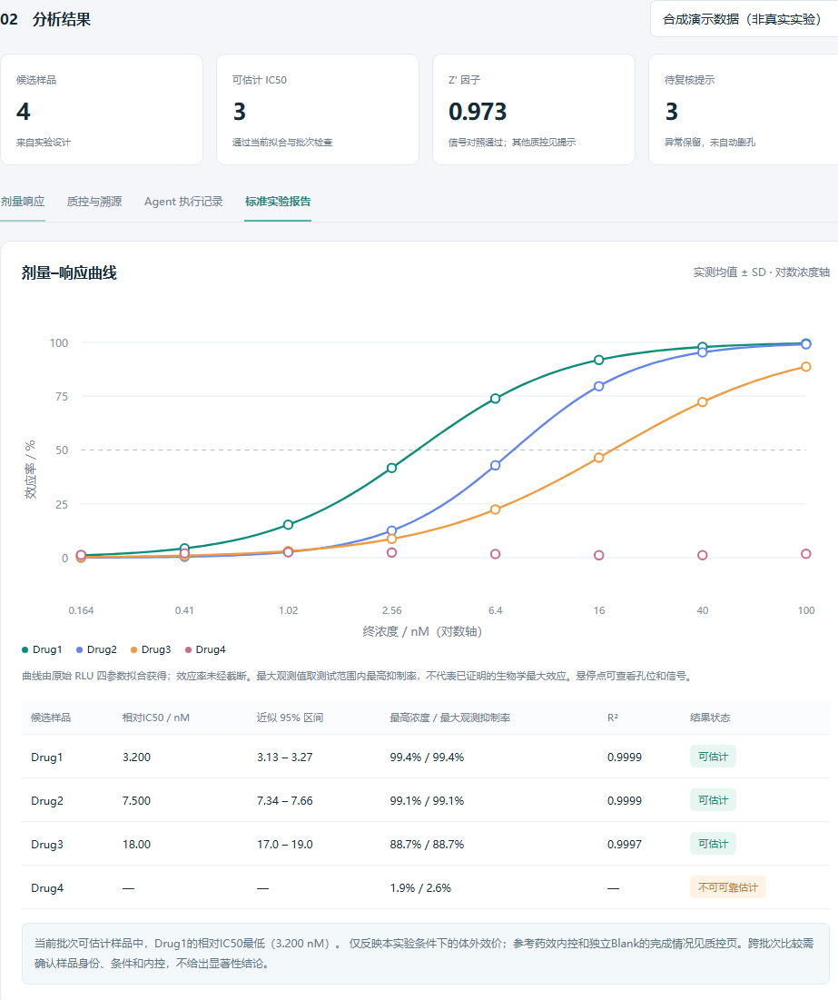
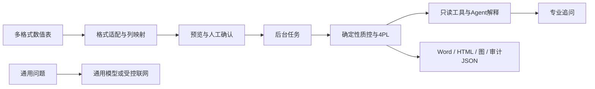

# AssayPilot

体外药理浓度响应分析与实验报告 Agent。支持多种表格格式、单文件长表、双文件设计关联、列名映射与单位转换；按场景输出 IC50、EC50 或 CC50，并生成可编辑 Word 报告。当前版本 `2.0.0-flexible-assays`。



**公开版所有自带数据均由数学模型合成。没有真实研发数据、企业试题、企业模板、公司标识或实际 API Key。** 示例用途是验证软件流程，不作生物学结论。

## 功能

- CSV/TSV/TXT/XLSX/JSON 上传；单文件长表或双文件原始信号+设计，支持96/384孔矩阵。
- 工作表、表头行、列名映射；pM/nM/µM/mM/M统一到nM；预览、人工确认、后台进度与失败提示。
- 复孔 CV、No Drug/Cell only、Z′、独立 Blank、用户指定参考药物检查。
- 按功能阻断、信号激活、细胞活力下降或酶抑制选择递减/递增4PL；相对IC50/EC50/CC50、绝对50%效应浓度、近似95%区间。
- 曲线不足时保留观测点，不强行报告 IC50；异常孔只标记、不删除。
- 标准版/简版 Word、HTML、PNG、审计 JSON、多批次 ZIP；HTML 可用浏览器打印为 PDF。
- 可选云模型：分析结果只读工具、专业追问、通用问答与公开联网查询。
- 本机访问令牌、来源校验、文件资源限制、公开网页 SSRF 防护、工具权限隔离和前端安全输出。

## 运行环境

完整启动器使用 Windows DPAPI，**目前支持 Windows + Python 3.11**。不需要 Node、数据库、向量库、云模型密钥或付费搜索密钥即可运行本地分析。

首次安装，在仓库根目录执行：

```powershell
python -m venv .venv
.\.venv\Scripts\python.exe -m pip install -r requirements-lock.txt
.\.venv\Scripts\python.exe pharma_agent\launch.py
```

以后双击 `start.cmd` 即可，启动器会选空闲端口并自动打开带本次访问凭证的页面。请用启动器打开；直接输入裸网址无法取得 API 访问权限。

示例操作：**选择分析场景与读出 → 上传长表（或原始信号+设计）→ 必要时选择工作表、表头行和列映射 → 识别 → 核对样品、单位和high/low对照 → 勾选确认 → 分析 → 导出。** 不启用模型时明确显示本地规则模式。页面下拉提供原96孔、单文件CSV、激活XLSX、JSON、任意表头和384孔示例。

数据规范、示例和已支持范围见 [适用性与导入说明](docs/APPLICABILITY.md)。

`requirements-lock.txt` 固定已验收的运行版本；`requirements.txt` 记录支持范围。开发验收额外安装 `requirements-dev-lock.txt`。

## 示例数据

`data/RAW DATA.csv` 与 `data/record.xlsx` 来自 `tools/generate_sample.py`。前三个样品的生成 IC50 为 3.2、7.5、18.0 nM；Drug4 是平坦曲线。8 个终浓度、双复孔、72 个设计孔，包含未加药和细胞基础对照。

```powershell
.\.venv\Scripts\python.exe tools\generate_sample.py
.\.venv\Scripts\python.exe tools\generate_flexible_samples.py
```

`data/manifest.json` 记录生成参数。`Result` 工作表故意填入假值，用于证明已有结果不参与计算。合成数据的高拟合度不能当作真实实验准确率指标。

## 架构



| 模块 | 职责 |
|---|---|
| `pharma_agent/server.py` | 本地 API、后台任务、进度、导出、访问控制 |
| `analysis.py` | 解析、孔位关联、质控、4PL 与数值证据 |
| `imports.py` / `datasets.py` / `assays.py` | 格式适配、单位转换、统一观测结构与场景语义 |
| `agent.py` / `question_routing.py` | 意图路由、只读工具、解释、降级 |
| `model_client.py` / `model_settings.py` | 供应商协议与本地配置 |
| `reports.py` | 项目自制报告版式、曲线与 HTML |
| `public_web.py` / `web_tools.py` / `live_tools.py` | 公开网页、搜索、论文、汇率、天气、新闻 |
| `web/index.html` | 上传、图表、报告和对话 |

## 模型与联网

页面可设置 DeepSeek、千问、OpenAI、Gemini、Mistral、Groq、OpenRouter 和自定义服务。候选名称需按账户当前可用模型核对。完整工具调用先请求模型读证据，再将工具结果交回模型解释。

配置说明见 [模型与数据流](docs/CONFIGURATION.md)。环境变量会被直接读取；项目不会自动加载 `.env` 文件。不要把真实 Key 写进仓库。

公开搜索入口稳定性有限；Tavily/Brave 需要独立密钥。公开网页不登录、不绕过验证码或付费墙，不执行网页脚本；实时股价、交易、下单等未实现。PDF文本读取是可选扩展，安装 `requirements-pdf-lock.txt` 前请阅读 [第三方范围](THIRD_PARTY_NOTICES.md)。

## 测试与安全

```powershell
.\.venv\Scripts\python.exe -m pip install -r requirements-dev-lock.txt
.\.venv\Scripts\python.exe -B -m unittest discover -s pharma_agent/tests -p "test_*.py"
.\.venv\Scripts\python.exe -B tools\verify_http.py
```

测试无需真实模型密钥，不会调用付费服务。模拟供应商响应只用于协议测试，不能当作供应商生产可用性证明。

参见 [安全边界](SECURITY.md)、[验收结果](docs/VALIDATION.md) 与 [发布步骤](docs/PUBLISH.md)。CI 文件已提供，上传后的实际运行结果需在 GitHub Actions 查看。

## 限制

- 支持长表及96/384孔矩阵；任意复杂宽表、旧XLS、图片/PDF的数值提取和自由文字实验设计需额外适配。
- 仅分析具有明确浓度、读数和高低信号对照的终点浓度响应；不处理酶动力学、时序、流式门控、图像或组学。
- CC50是活力下降曲线相对中点；不能单凭活力信号断言细胞死亡。酶IC50不等于Ki。
- 默认质控阈值是演示规则，需按业务 SOP 验证。
- 缺失 Blank、内控或元数据时明确显示缺失，不自动补写。
- 批次只作描述性比较，无统计显著性结论。
- 历史任务保存在进程内存，重启清空；结果应主动导出。
- 单用户本机运行，无生产多用户授权、TLS 或集中审计。
- 云模型会收到结构化结果和必要文本；实际企业数据需获准的服务与策略。

许可证和第三方范围见根目录许可证文件。公开版与企业现场使用的专用模板版本独立维护。
